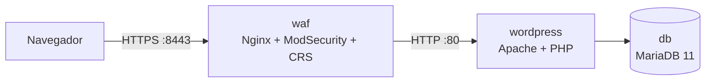

# WordPress seguro — plantilla del curso

Este repositorio despliega un **WordPress detrás de un WAF** (Nginx con ModSecurity v3 y el OWASP Core Rule Set 4) con HTTPS. En el curso de Puesta en Producción Segura lo usamos para trabajar el endurecimiento de servidores web: TLS, cabeceras de seguridad, reglas del WAF y seguridad de un CMS.



Solo el WAF publica puertos: WordPress y la base de datos quedan en la red interna de Docker Compose.

## Crea tu copia

```bash
gh repo create pps-cifpaviles/a07-wordpress --template pps-cifpaviles/plantilla-wordpress --public --clone
cd a07-wordpress
git switch develop
```

Sustituye `07` por tu número de alumno.

## Pruébalo en tu equipo

```bash
cp .env.example .env
scripts/certificado-local.sh       # certificado autofirmado y contraseña de la BD
docker compose up -d
docker compose ps                  # db debe estar "healthy"
```

Abre <https://localhost:8443> (acepta el aviso del certificado autofirmado) y completa el instalador de WordPress.

Prueba el WAF con una petición maliciosa y mira el log:

```bash
curl -k "https://localhost:8443/?id=1'%20OR%20'1'='1"
docker compose logs waf | grep -i "ModSecurity"
```

En modo `DetectionOnly` la petición pasa, pero queda registrada (regla 942100, inyección SQL). Con `MODSEC_RULE_ENGINE=On` en `.env` y `docker compose up -d`, la respuesta es un 403.

## Ficheros

| Fichero | Para qué sirve |
| --- | --- |
| `compose.yml` | Los tres servicios. Lo usan tanto tu equipo como el pipeline |
| `config/modsecurity/*.conf` | Exclusiones del CRS para corregir falsos positivos |
| `scripts/certificado-local.sh` | Certificado autofirmado y contraseña para pruebas locales |
| `deploy/deploy.sh` | Despliegue en las VM del aula con tu rango de puertos y la CA del aula |
| `.github/workflows/pipeline.yml` | Pipeline base: validación y despliegue en los tres entornos |

## Pipeline y entornos

| Evento | Entorno | URL (alumno 07) |
| --- | --- | --- |
| Push a `develop` | `desarrollo` | `https://pps-dev.aula.lan:20731` |
| Push a `release/**` | `preproduccion` | `https://pps-pre.aula.lan:20731` |
| Tag `v*` (con aprobación) | `produccion` | `https://pps-pro.aula.lan:20731` |

El puerto HTTPS es `20000 + NN×100 + 31` y el HTTP, `+30`. Antes del primer despliegue, crea el secreto de la base de datos en cada entorno:

```bash
for ENV in desarrollo preproduccion produccion; do
  gh secret set WP_DB_PASSWORD --env $ENV --body "$(openssl rand -base64 24)"
done
```

## Endurecimiento ya aplicado

- WordPress no publica puertos: todo el tráfico pasa por el WAF.
- `DISALLOW_FILE_EDIT`: no se pueden editar temas ni plugins desde el panel.
- Actualizaciones automáticas menores del núcleo.
- La contraseña de la base de datos va como *secret* de Docker (fichero), no como variable en claro.

En el Lab 6 completarás el resto: TLS solo 1.2/1.3, cabeceras (HSTS, CSP, X-Content-Type-Options…), WAF en modo bloqueo con exclusiones ajustadas, `xmlrpc.php`, WPScan y Lynis en el pipeline.

## Colaboradores

<!-- Añade aquí tu nombre y tu usuario de GitHub. -->
